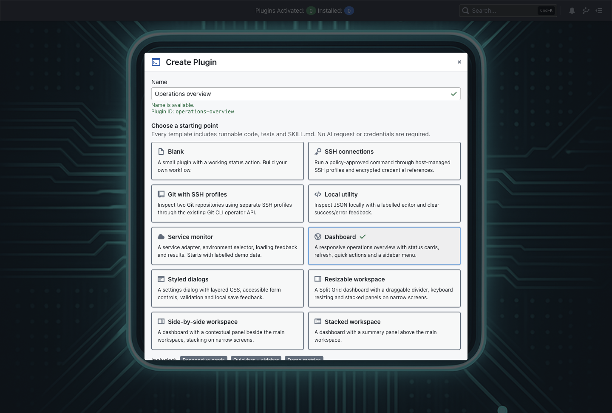

# FDO plugin templates

Open **Create Plugin** from the Plugins menu or command search. Enter a name,
select a template card, and choose **Open editor**. Templates are bundled with
FDO: creation does not call an AI provider.

Names are validated as you type, with an inline explanation and a preview of the
generated plugin ID. Use up to 80 characters, starting with a letter or number;
spaces, hyphens, underscores and dots are allowed. Include an English letter or
number for the ID. Windows reserved names are rejected for portability.

FDO checks installed plugins and saved workspaces for ID collisions, and checks
again before opening the editor. A collision offers **Open existing plugin** or
**Resume saved workspace** instead of creating over existing work. These actions
do not apply the selected template. If the installed-plugin check fails, use
**Retry name check** before continuing.

| Template               | Working starting behavior                                                                                                                                           |
| ---------------------- | ------------------------------------------------------------------------------------------------------------------------------------------------------------------- |
| Blank                  | Metadata, a status button and a styled page.                                                                                                                        |
| SSH connections        | Host-managed SSH profiles and a policy-approved remote uptime inspection; built-in cross-platform SSH client. Configure a credential, profile and trusted host key. |
| Git with SSH profiles  | Inspect remote references for two repositories using separate SSH profiles. Requires an installed, approved Git executable on the computer running FDO.             |
| Local utility          | Local JSON inspection with type, count, top-level keys and malformed-input feedback.                                                                                |
| Service monitor        | Environment selection, an asynchronous demo adapter, loading feedback and service results.                                                                          |
| Dashboard              | Demo overview/activity cards with refresh, quickbar action and sidebar navigation.                                                                                  |
| Styled dialogs         | Local workspace settings with a native modal dialog, validation, session-local saving and layered CSS.                                                              |
| Resizable workspace    | Injected Split Grid with a draggable and keyboard-accessible divider; panels stack at 640px.                                                                        |
| Side-by-side workspace | Dashboard with contextual and main panels beside one another; stacks on narrow screens.                                                                             |
| Stacked workspace      | Dashboard with contextual and main panels arranged vertically.                                                                                                      |

All templates contain `/index.ts`, `/render.tsx`, `/styles.css`, executable
`node:test` tests, `/package.json`, `/SKILL.md` and `/README.md`. Starters add helper modules for their behavior, rendering and text escaping;
connection starters also include their profile/capability configuration. The exact
files vary by template.

The guide describes the selected starter, modules, SDK conventions and extension
points. It is authored as part of the bundled template, rather than an AI-generated
proposal. Selecting a template does not bypass approval of later AI guide changes.

## Actual template source

These are the bundled generators used by Create Plugin, not external sample projects.
The [template picker catalog](../src/utils/plugins/authoring/pluginTemplateCatalog.js)
contains all ten choices and their stable IDs.

| Template               | ID           | Source generator                                                                                                                                            |
| ---------------------- | ------------ | ----------------------------------------------------------------------------------------------------------------------------------------------------------- |
| Blank                  | `blank`      | [Blank factory](../src/components/editor/utils/virtualTemplates.js)                                                                                         |
| SSH connections        | `ssh`        | [SSH starter](../src/components/editor/utils/templates/sshConnectionTemplate.js)                                                                            |
| Git with SSH profiles  | `gitSsh`     | [Git/SSH starter](../src/components/editor/utils/templates/gitConnectionTemplate.js)                                                                        |
| Local utility          | `utility`    | [Shared starter factory](../src/components/editor/utils/templates/starterFiles.js)                                                                          |
| Service monitor        | `service`    | [Shared starter factory](../src/components/editor/utils/templates/starterFiles.js)                                                                          |
| Dashboard              | `dashboard`  | [Shared starter factory](../src/components/editor/utils/templates/starterFiles.js)                                                                          |
| Styled dialogs         | `dialogs`    | [Dialog starter](../src/components/editor/utils/templates/dialogTemplate.js)                                                                                |
| Resizable workspace    | `splitGrid`  | [Starter factory](../src/components/editor/utils/templates/starterFiles.js) and [split layout](../src/components/editor/utils/templates/splitGridLayout.js) |
| Side-by-side workspace | `horDivided` | [Shared starter factory](../src/components/editor/utils/templates/starterFiles.js)                                                                          |
| Stacked workspace      | `verDivided` | [Shared starter factory](../src/components/editor/utils/templates/starterFiles.js)                                                                          |



## Built-in services versus installed tools

- FDO's SSH client is built in and works on macOS, Windows and Linux. SDK SSH
  profiles and commands do not require a separately installed `ssh` executable.
  The remote command must still exist on the remote server; the SSH starter's
  `uptime` example expects a compatible remote environment.
- GitOps repository synchronization uses FDO's bundled Git. System Git is not
  required for that feature.
- Git or any other CLI invoked by a plugin must be installed on the computer
  running FDO and allowed by its process scope. GitOps's private Git runtime is
  not an automatic dependency installer for plugins.
- In an exported Docker app, declare and install the required CLIs in the
  container. The desktop computer's tools and login sessions are not copied.
  See [plugin deployment tools](PLUGIN_DEPLOYMENT_TOOLS.md).

## First steps in the IDE

1. Read `/README.md` and `/SKILL.md`.
2. Customize metadata in `/index.ts`.
3. Use **Run tests** to verify the starter, then **Build / Compile**.
4. Deploy using your certificate and try the controls in the running plugin.
5. For dashboard starters, open the plugin menu in the right sidebar or select
   Refresh dashboard in command search. See [Plugin UI actions](PLUGIN_UI_ACTIONS.md).

Saved sandboxes and existing on-disk workspaces are restored without applying
new template content over them. Selecting a different template is for a fresh
workspace; it is not an operation that replaces existing code.

## Service monitor and dashboard demo data

The service adapter and dashboard metrics are clearly labelled **demo**. They
work without network access, credentials or privileged capability grants. The
service adapter validates the environment and returns a predictable result;
its tests cover staging, production and invalid input.

To integrate a real service, replace the adapter in `/logic.ts`, declare required
capabilities, and use the installed SDK/host network and authentication contracts.
Keep endpoint configuration explicit and secrets outside source code. No live
service integration or credential storage is implied by this starter.

## Styling contract

`/styles.css` contains standard CSS, not SCSS. Import its default export with
`import styles from './styles.css'`. FDO converts selectors into SDK style-map
entries. The renderer creates one SDK `DOM`, registers each used entry with
`dom.createClassFromStyle(styles.panel)`, composes HTML with the returned class
names, and calls `renderHTML` on that same instance.

Builds and Node render tests use the same CSS transformation, including relative
CSS imports, selector states, descendants and media rules. CSS imports are not
browser-injected stylesheets or CSS Modules class-name strings. Keep base classes
registered so their state and conditional rules accompany them. Existing saved
workspaces retain their original files; this changes newly created templates.

## Styled dialogs

Choose **Styled dialogs**, then **Configure workspace** in the running plugin.
The native `<dialog>` provides modal focus containment, Escape dismissal and
focus restoration. Cancel discards unsaved form edits. Saving validates the
label and environment on the backend and updates local settings for the running
plugin session; it does not deploy, call an external service, or persist across
plugin restarts. Failed saves leave the dialog open with an error and allow retry.
The iframe blocks native form submission, so Save uses explicit SDK action
bindings for button clicks and Enter in the label input, with form validation.

The stylesheet demonstrates gradients, borders and shadows, `::backdrop`, hover,
focus and disabled states, status selectors, descendant rules and a narrow-screen
media query. Edit `/styles.css` to restyle it while preserving accessible labels
and focus indicators.

## Resizable workspace

The Resizable workspace template follows the SDK's
`07-injected-libraries-demo.ts` example. It uses the injected `window.Split`;
no Split Grid package import or external request is needed.

Drag the divider or focus it and use Left/Right (5% steps), Shift+arrows (10%),
Home (20%) and End (80%). Panels stack at iframe widths of 640px or less. The
chosen ratio survives view rerenders and returning to a wide layout within the
same running iframe; it is not persisted across app restarts.

`/split-layout.ts` is the self-contained setup callback supplied to
`defineRenderOnLoadActions`. It destroys previous Split instances and removes
listeners on rerender, unmount and page exit. Keep that cleanup when extending
it. If the injected library is unavailable, keyboard resizing remains usable.

## Maintaining templates

- Picker metadata: `src/utils/plugins/authoring/pluginTemplateCatalog.js`.
- Workspace factory and Blank: `src/components/editor/utils/virtualTemplates.js`.
- Shared starter generators: `src/components/editor/utils/templates/`.
- Scaffolding and restoration: `setupVirtualWorkspace.js` in the editor utils.

Keep advertised behavior, guide content and executable tests consistent. Legacy
`horDivided` / `verDivided` template IDs remain supported and now generate real
workspaces.

```sh
npx jest tests/unit/plugin-starter-templates.test.js tests/components/CreatePluginDialog.test.jsx tests/components/editor/utils/setupVirtualWorkspace.test.js --runInBand
npx playwright test tests/e2e/plugin-templates.spec.js --workers=1
```

The unit suite type-checks every generated workspace against the installed SDK
and runs each workspace's generated Node tests. The Electron suite exercises real
UI actions and style emission, plus template selection opening a native editor.
Build FDO first when testing renderer changes.
